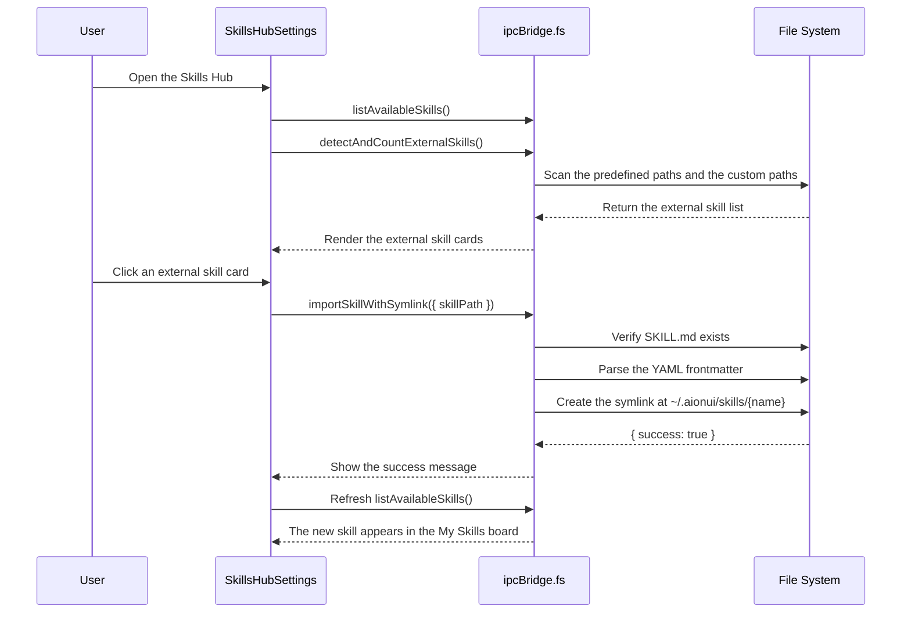
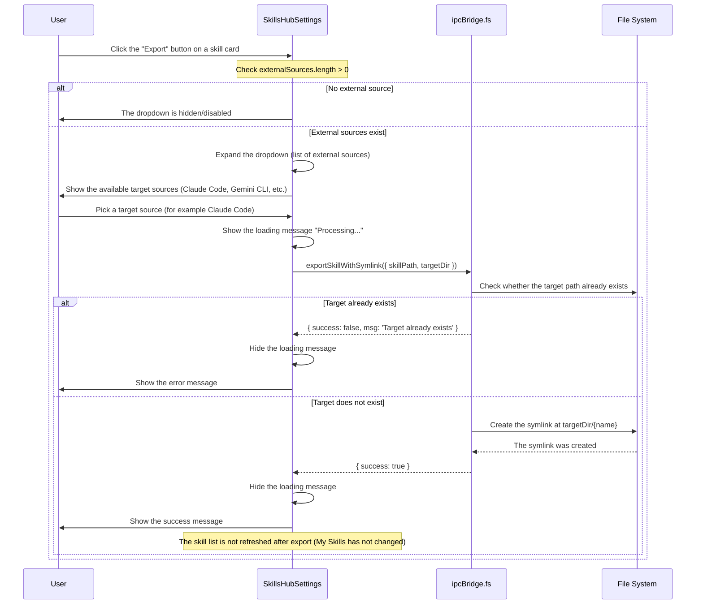
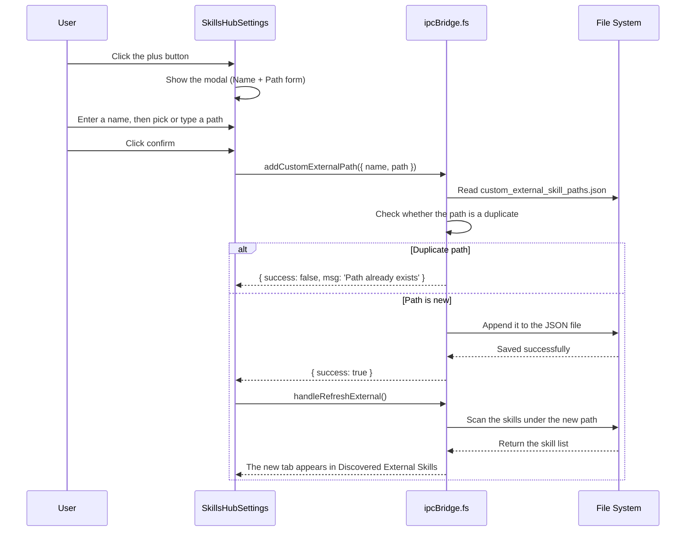

# SkillsHubSettings Functional Requirements

## 1. Page Overview and Purpose

**Page path**: `src/renderer/pages/settings/SkillsHubSettings.tsx`

**Core positioning**: SkillsHub is AionUi's unified skill management platform. It offers one-stop skill import, export, deletion, search, and categorized display. Users manage every skill their AI agents need from this single page, achieving "install once, available to every assistant".

**Supported modes**:

- Embedded mode (`withWrapper=false`): can be embedded in a tab page; the outer `SettingsPageWrapper` is not rendered
- Standalone mode (`withWrapper=true`, the default): rendered as a complete settings page

**Skill source categories**:

1. **Built-in Skills**: located in the `builtin-skills/` directory
2. **Custom Skills**: located in the user directory `~/.aionui/skills/`
3. **Extension Skills**: contributed by the ExtensionRegistry
4. **Auto-injected Skills**: located in the `_builtin/` directory; the user does not need to select them

---

## 2. Feature Inventory

### 2.1 Skill list display

#### 2.1.1 My Skills

**Source location**: `SkillsHubSettings.tsx:392-592`

**Description**:

- Displays the builtin and custom skills the user has imported
- Each skill card contains:
  - An avatar (the capitalized first letter, colored by a hash of the name): `SkillsHubSettings.tsx:26-41`
  - The skill name (`skill.name`)
  - A source badge (builtin / custom): `SkillsHubSettings.tsx:471-479`
  - The skill description (`skill.description`, line-clamp-2): `SkillsHubSettings.tsx:481-488`
  - An action button area (shown on hover): export, delete

**Data source**:

- Bridge call: `ipcBridge.fs.listAvailableSkills.invoke()` → `fsBridge.ts:1036-1139`
- Filtering logic: excludes `source === 'extension'` (`SkillsHubSettings.tsx:67`)

**Search**:

- Search box location: `SkillsHubSettings.tsx:415-426`
- Search scope: skill name and description (case-insensitive)
- Implementation: the `filteredSkills` computed value (`SkillsHubSettings.tsx:70-77`)

**Refresh**:

- Refresh button: `SkillsHubSettings.tsx:402-411`
- Triggers `fetchData()`, which re-fetches every skill list

**When the list refreshes automatically** (every case that triggers `fetchData()`):

1. **Component mount**: `useEffect(() => { void fetchData(); }, [fetchData])` (`SkillsHubSettings.tsx:106-108`)
2. **Manually clicking the refresh button**: `SkillsHubSettings.tsx:404-407`
3. **After a successful import**: `handleImport` calls `void fetchData()` on success (`SkillsHubSettings.tsx:135`)
4. **After a successful delete**: `handleDelete` calls `void fetchData()` on success (`SkillsHubSettings.tsx:171`)
5. **After a successful batch import**: `handleImportAll` calls `void fetchData()` when at least one item succeeded (`SkillsHubSettings.tsx:162`)
6. **After adding a custom path**: the external skills are refreshed indirectly through `handleRefreshExternal()` (`SkillsHubSettings.tsx:223`)

**When the list does not refresh**:

- **After a successful export**: `fetchData()` is not called, because the My Skills list has not changed (only a symlink is added to the external CLI directory)

**Empty state message**:

- Shown when there are no skills: `locales/en-US/settings.json:11` "No skills found. Import some to get started."

**Behaviour when a search returns nothing**:

- Source logic: `SkillsHubSettings.tsx:450-591`
- When `filteredSkills.length === 0`, the else branch runs and shows the "No skills found" message (`SkillsHubSettings.tsx:584-590`)
- **Scenario distinction**:
  1. No skills plus an empty search: shows "No skills found. Import some to get started."
  2. Skills exist but the search has no match: **shows the same message**, "No skills found. Import some to get started." (the two cases are indistinguishable)
- **Note**: the current implementation cannot distinguish "no skills" from "search returned no match", which may hurt the user experience

**testid availability**: ❌ missing

- **Test dependencies (P0 priority)**: the following data-testid attributes must be added:
  - Board container: `my-skills-section`
  - Skill card: `my-skill-card-${normalizedName}` (must be escaped, see 7.2.1)
  - Delete button: `delete-skill-button-${normalizedName}`
- **Test dependencies (P1 priority)**:
  - Search box: `my-skills-search-input`
  - Refresh button: `my-skills-refresh-button`
  - Manual import button: `manual-import-button`
- **Test dependencies (P2 priority)**:
  - Export button: `export-skill-button-${normalizedName}`
  - Export dropdown: `export-dropdown-${normalizedName}`

---

#### 2.1.2 Discovered External Skills

**Source location**: `SkillsHubSettings.tsx:248-389`

**Description**:

- Automatically scans the skill directories of common CLI tools (Claude Code, Gemini CLI, OpenCode, and others)
- Shows skills from different sources across multiple tabs
- Supports search, batch import, and single-item import

**Scanned sources** (`fsBridge.ts:1486-1627`):

- `~/.agents/skills` (Global Agents)
- `~/.gemini/skills` (Gemini CLI)
- `~/.claude/skills` (Claude Code)
- `~/.config/opencode/skills` (OpenCode)
- `~/.opencode/skills` (OpenCode Alt)
- Custom paths (persisted through `custom_external_skill_paths.json`)

**Tab switching**:

- Tab buttons: `SkillsHubSettings.tsx:293-309`
- State: `activeSourceTab` → `setActiveSourceTab`
- Shows a count badge for the skills in the current source

**Adding a custom path**:

- Trigger button: `SkillsHubSettings.tsx:311-318` (the plus button)
- Modal form: `SkillsHubSettings.tsx:699-759`
- Bridge call: `ipcBridge.fs.addCustomExternalPath.invoke({ name, path })`
- Implementation: `fsBridge.ts:1455-1470`

**Batch import**:

- Button location: `SkillsHubSettings.tsx:330-335`
- Logic: `handleImportAll(activeSource.skills)` → `SkillsHubSettings.tsx:145-164`
- Calls `importSkillWithSymlink` for each skill in turn and accumulates the success count

**Single-item import**:

- Triggered by clicking the card or the Import button
- Call: `ipcBridge.fs.importSkillWithSymlink.invoke({ skillPath })`
- Implementation: `fsBridge.ts:1629-1676` (creates the symlink)

**Refreshing external skills**:

- Refresh button: `SkillsHubSettings.tsx:261-267`
- Triggers `handleRefreshExternal()` → `SkillsHubSettings.tsx:194-210`
- Calls `ipcBridge.fs.detectAndCountExternalSkills.invoke()` again

**Search**:

- Search box: `SkillsHubSettings.tsx:277-288`
- State: `searchExternalQuery`
- Filtering logic: `filteredExternalSkills` (`SkillsHubSettings.tsx:235-243`)

**Skill pack support**:

- Two structures are recognized:
  1. Direct skill: the directory contains `SKILL.md` directly
  2. Nested skill pack: the directory has a `skills/` subdirectory in which each subdirectory is an independent skill
- Implementation: `fsBridge.ts:1551-1600`

**testid availability**: ❌ missing

- **Test dependencies (P0 priority)**:
  - Board container: `external-skills-section`
  - External skill card: `external-skill-card-${normalizedName}` (must be escaped, see 7.2.1)
  - Single import button: `import-skill-button-${normalizedName}`
  - Batch import button: `import-all-skills-button`
- **Test dependencies (P1 priority)**:
  - Search box: `external-skills-search-input`
  - Refresh button: `external-skills-refresh-button`
  - Add path button: `add-custom-path-button`
  - Add path modal: `add-custom-path-modal`
- **Test dependencies (P2 priority)**:
  - Tab button: `external-source-tab-${source.source}`

---

#### 2.1.3 Extension Skills

**Source location**: `SkillsHubSettings.tsx:594-635`

**Description**:

- Displays the skills contributed by extension plugins (`source === 'extension'`)
- Read-only display: they cannot be deleted or exported
- Card styling: a purple puzzle icon plus an Extension badge

**Data source**:

- Filters `source === 'extension'` out of the data returned by `listAvailableSkills`
- Extension registration logic: `fsBridge.ts:1103-1118` (calls `ExtensionRegistry.getInstance().getSkills()`)

**testid availability**: ❌ missing

- **Test dependency**: `extension-skill-card-${skill.name}` must be added

---

#### 2.1.4 Auto-injected Skills

**Source location**: `SkillsHubSettings.tsx:637-678`

**Description**:

- Displays the builtin skills the system injects automatically (the user does not select them)
- Source directory: the `_builtin/` subdirectory
- Card styling: a green lightning icon plus an Auto badge

**Data source**:

- Bridge call: `ipcBridge.fs.listBuiltinAutoSkills.invoke()` → `fsBridge.ts:1142-1181`
- Scans every skill under the `getAutoSkillsDir()` directory

**testid availability**: ❌ missing

- **Test dependency**: `auto-skill-card-${skill.name}` must be added

---

### 2.2 Skill import

#### 2.2.1 Manual import from a folder

**Source location**: `SkillsHubSettings.tsx:428-436`

**Description**:

- Clicking the "Import from Folder" button opens the file picker
- The user selects a directory that contains a `SKILL.md`
- The skill is imported into the user directory as a symlink

**Implementation flow**:

1. Call `ipcBridge.dialog.showOpen.invoke({ properties: ['openDirectory', 'createDirectory'] })` (`SkillsHubSettings.tsx:183-186`)
2. Once a path is returned, call `handleImport(skillPath)` → `SkillsHubSettings.tsx:128-143`
3. Bridge call: `ipcBridge.fs.importSkillWithSymlink.invoke({ skillPath })`
4. Implementation: `fsBridge.ts:1629-1676`
   - Verifies that `SKILL.md` exists
   - Parses the YAML frontmatter to get the skill name
   - Creates the symlink: `fs.symlink(skillPath, targetDir, 'junction')`
   - Target path: `~/.aionui/skills/{skillName}`

**Boundary handling**:

- The directory has no `SKILL.md`: returns `{ success: false, msg: 'SKILL.md file not found' }`
- The skill already exists: returns `{ success: false, msg: 'Skill already exists' }`

**testid availability**: ❌ missing

- **Test dependency**: `manual-import-button` must be added

---

#### 2.2.2 Symlink import

**Source location**: `fsBridge.ts:1629-1676`

**Description**:

- Uses a symbolic link (a junction on Windows) instead of copying files
- Advantages: saves space, and edits to the source files take effect immediately
- Use case: importing external CLI skills or skills from a user-defined path

**Implementation details**:

- Windows: `fs.symlink(src, dest, 'junction')`
- macOS/Linux: `fs.symlink(src, dest, 'dir')`
- The target directory is created automatically when it does not exist: `fs.mkdir(userSkillsDir, { recursive: true })`

**testid availability**: N/A (backend logic)

---

#### 2.2.3 Batch import (Import All)

**Source location**: `SkillsHubSettings.tsx:145-164`

**Description**:

- Imports every skill from one external source at once
- A failure does not abort the run; the remaining skills are still attempted
- Displays the number of successfully imported skills

**Implementation logic**:

```typescript
for (const skill of skills) {
  try {
    const result = await ipcBridge.fs.importSkillWithSymlink.invoke({ skillPath: skill.path });
    if (result.success) successCount++;
  } catch {
    // continue
  }
}
```

**UI state notes**:

- **Loading state**: ❌ none (the button is not disabled during the import and there is no loading indicator)
- **Progress feedback**: ❌ none (the current import progress cannot be seen)
- **Cancellation**: ❌ none (a batch import cannot be cancelled part way through)
- **Failure handling**: a single skill failing does not abort the run; the remaining skills are still imported
- **Success message**: only the total success count is shown (`importAllSuccess: "{{count}} skills imported"`)

**Performance impact**:

- Importing 10 or more skills may block UI responsiveness (there is no loading state)
- Suggested test: UI smoothness while batch importing 20 skills

**testid availability**: ❌ missing

- **Test dependencies**: already listed in 2.1.2

---

### 2.3 Skill export

#### 2.3.1 Export to an external source

**Source location**: `SkillsHubSettings.tsx:492-558`

**Description**:

- Exports (pushes) a skill from My Skills into an external CLI tool's skill directory
- Only custom and builtin skills are supported (extension skills are not)
- The target source is chosen from a dropdown menu

**Implementation flow**:

1. Click the "Export" button on the skill card (`SkillsHubSettings.tsx:550-558`)
2. The dropdown lists every detected external source (`SkillsHubSettings.tsx:493-559`)
3. After picking the target source, it calls:
   ```typescript
   const skillPath = skill.location.replace(/[\\/]SKILL\.md$/, '');
   await ipcBridge.fs.exportSkillWithSymlink.invoke({ skillPath, targetDir: source.path });
   ```
4. Bridge implementation: `fsBridge.ts:1724-1755`
   - Checks whether the target path already exists
   - Creates the symlink: `fs.symlink(skillPath, targetPath, 'junction')`

**Timeout protection**:

- An 8 second timeout limit (`SkillsHubSettings.tsx:511-519`)
- An error message is shown after the timeout

**Boundary handling**:

- Target already exists: `{ success: false, msg: 'Target already exists' }`
- No source available to export to: the dropdown is not shown

**testid availability**: ❌ missing

- **Test dependencies**: `export-skill-button-${skill.name}` and `export-dropdown-${skill.name}` must be added

---

### 2.4 Skill deletion

#### 2.4.1 Delete a custom skill

**Source location**: `SkillsHubSettings.tsx:560-579`

**Description**:

- Only custom skills can be deleted (builtin, extension, and auto skills cannot)
- A confirmation dialog appears before deleting
- Handles both symlinks and real directories

**Implementation flow**:

1. Click the delete button (`SkillsHubSettings.tsx:561-578`)
2. Modal confirmation: `Modal.confirm()` → `locales/settings.json:24-25`
3. Bridge call: `ipcBridge.fs.deleteSkill.invoke({ skillName })`
4. Implementation: `fsBridge.ts:1679-1715`
   - Safety check: makes sure the path is inside `userSkillsDir`
   - Determines whether it is a symlink: `fs.lstat(resolvedSkillDir)`
   - Symlink: `fs.unlink()`
   - Real directory: `fs.rm({ recursive: true, force: true })`

**Security boundary**:

- Path traversal protection: `resolvedSkillDir.startsWith(resolvedSkillsDir + path.sep)` (`fsBridge.ts:1686-1691`)
- Skill does not exist: returns `{ success: false, msg: 'Skill not found' }`

**testid availability**: ❌ missing

- **Test dependencies**: already listed in 2.1.1 (P0 priority)

---

#### 2.7.3 Remove a custom external path

**Source location**: `fsBridge.ts:1472-1483` (bridge implementation)

**Description**:

- The bridge layer already implements removing a custom external path
- **Current status**: ❌ **not implemented in the UI** (the frontend never calls `removeCustomExternalPath`)

**Bridge implementation**:

```typescript
ipcBridge.fs.removeCustomExternalPath.provider(async ({ path: skillPath }) => {
  try {
    const existing = await loadCustomExternalPaths();
    const filtered = existing.filter((p) => p.path !== skillPath);
    await saveCustomExternalPaths(filtered);
    return { success: true, msg: 'Custom path removed' };
  } catch (error) {
    return { success: false, msg: 'Failed to remove path' };
  }
});
```

**Impact**:

- Once a user adds an incorrect path, they cannot remove it from the UI
- They must edit `~/.aionui/custom_external_skill_paths.json` by hand

**Recommendation**:

- A future version should add a delete icon or a context menu on the tab button
- E2E test scope: this feature is **excluded** (it is not implemented in the UI)

**testid availability**: N/A (the feature is not implemented)

---

### 2.5 Skill search and filtering

#### 2.5.1 My Skills search

**Source location**: `SkillsHubSettings.tsx:415-426` / `SkillsHubSettings.tsx:70-77`

**Description**:

- Searches skill names and descriptions in real time
- Case-insensitive
- Shows everything when the query is empty

**Implementation logic**:

```typescript
const filteredSkills = useMemo(() => {
  if (!searchQuery.trim()) return mySkills;
  const lowerQuery = searchQuery.toLowerCase();
  return mySkills.filter(
    (s) =>
      s.name.toLowerCase().includes(lowerQuery) || (s.description && s.description.toLowerCase().includes(lowerQuery))
  );
}, [mySkills, searchQuery]);
```

**No-results message**: there is no dedicated no-results message (the cards simply are not shown)

**testid availability**: ❌ missing

- **Test dependencies**: already listed in 2.1.1

---

#### 2.5.2 External skills search

**Source location**: `SkillsHubSettings.tsx:277-288` / `SkillsHubSettings.tsx:235-243`

**Description**:

- Searches only the skills in the currently selected tab
- The search logic is the same as in 2.5.1

**No-results message**:

- Shows: `locales/settings.json:39` "No matching skills found"
- UI: `SkillsHubSettings.tsx:380-384` (an empty state card with a dashed border)

**testid availability**: ❌ missing

- **Test dependencies**: already listed in 2.1.2

---

### 2.6 Skill scanning and detection

#### 2.6.1 Scanning the common paths

**Source location**: `fsBridge.ts:1388-1430` (detectCommonSkillPaths)

**Description**:

- Scans the predefined skill directories of common CLI tools
- Returns the list of paths that exist

**Scan list**:

```typescript
[
  { name: 'Global Agents', path: '~/.agents/skills' },
  { name: 'Gemini CLI', path: '~/.gemini/skills' },
  { name: 'Claude Code', path: '~/.claude/skills' },
  { name: 'OpenCode', path: '~/.config/opencode/skills' },
  { name: 'OpenCode (Alt)', path: '~/.opencode/skills' },
];
```

**testid availability**: N/A (backend logic)

---

#### 2.6.2 Deep directory scanning

**Source location**: `fsBridge.ts:1309-1385` (scanForSkills)

**Description**:

- Scans a user-specified directory for every `SKILL.md` file
- Supports two levels of scanning:
  1. The immediate subdirectories of the current directory
  2. Whether the current directory itself contains a `SKILL.md`

**YAML parsing**:

- Parses the frontmatter to extract `name` and `description`
- Regex: `/^---\s*\n([\s\S]*?)\n---/`

**testid availability**: N/A (backend logic)

---

### 2.7 Skill path management

#### 2.7.1 Adding a custom external path

**Source location**: `SkillsHubSettings.tsx:699-759` (modal) / `fsBridge.ts:1455-1470`

**Description**:

- Lets the user add a skill directory that is not in the predefined list
- Supports both the file picker and manual entry
- Persisted to `custom_external_skill_paths.json`

**Form fields**:

- Name (path alias): required, `locales/settings.json:35`
- Path (directory path): required, `locales/settings.json:36-37`

**Implementation flow**:

1. The user fills in the modal form
2. Bridge call: `ipcBridge.fs.addCustomExternalPath.invoke({ name, path })`
3. Read the existing configuration: `loadCustomExternalPaths()` (`fsBridge.ts:1436-1443`)
4. Deduplication check: `existing.some(p => p.path === skillPath)`
5. Append the new path and save: `saveCustomExternalPaths()` (`fsBridge.ts:1446-1449`)
6. Refresh the external skills list

**File picker integration**:

- Triggered by clicking the FolderOpen icon (`SkillsHubSettings.tsx:739-756`)
- Fills in the Path field automatically

**testid availability**: ❌ missing

- **Test dependencies**: the following data-testid attributes must be added:
  - Modal: `add-custom-path-modal`
  - Name input: `custom-path-name-input`
  - Path input: `custom-path-value-input`
  - Browse button: `custom-path-browse-button`
  - Confirm button: the modal's default ok button

---

#### 2.7.2 Getting the skill storage paths

**Source location**: `fsBridge.ts:1718-1721` (getSkillPaths)

**Description**:

- Returns the user skill directory and the builtin skill directory paths
- Used by the frontend to display where the directories live

**Return value**:

```typescript
{
  userSkillsDir: string; // ~/.aionui/skills
  builtinSkillsDir: string; // builtin-skills/
}
```

**testid availability**: N/A (backend logic)

---

### 2.8 Skill highlight and scroll-to

#### 2.8.1 Highlight triggered by a URL parameter

**Source location**: `SkillsHubSettings.tsx:110-126`

**Description**:

- The `?highlight=skillName` URL parameter navigates to and highlights the named skill
- The page scrolls to the target skill card automatically
- The highlight is removed after 2 seconds

**Implementation logic**:

```typescript
useEffect(() => {
  if (!highlightName || loading) return;
  const el = skillRefs.current[highlightName];
  if (el) {
    requestAnimationFrame(() => {
      el.scrollIntoView({ behavior: 'smooth', block: 'center' });
      setHighlightedSkill(highlightName);
      const timer = setTimeout(() => setHighlightedSkill(null), 2000);
      setSearchParams({}, { replace: true });
      return () => clearTimeout(timer);
    });
  }
}, [highlightName, loading, availableSkills, setSearchParams]);
```

**Highlight styling**:

- Border: `border-primary-5`
- Background: `bg-primary-1`
- Applied through a conditional in the skill card's className

**Clearing the URL**:

- Once the scroll finishes, `setSearchParams({}, { replace: true })` removes the parameter

**testid availability**: ✅ can be located through the URL plus the ref

---

### 2.9 Internationalization support

#### 2.9.1 i18n text coverage

**Source files**: `src/renderer/services/i18n/locales/*/settings.json` (key: `skillsHub`)

**Full i18n key map**:

| key                         | Purpose                                 | Example value (en-US)                                    |
| --------------------------- | --------------------------------------- | -------------------------------------------------------- |
| `title`                     | Page title                              | "Skills Hub"                                             |
| `description`               | Page description                        | "Centrally manage AI agent skills..."                    |
| `mySkillsTitle`             | My Skills board title                   | "My Skills"                                              |
| `discoveredTitle`           | External skills board title             | "Discovered External Skills"                             |
| `discoveryAlert`            | External skills notice                  | "Detected skills from your CLI tools..."                 |
| `noSkills`                  | Empty state message                     | "No skills found. Import some to get started."           |
| `custom`                    | Custom skill badge                      | "Custom"                                                 |
| `builtin`                   | Builtin skill badge                     | "Built-in"                                               |
| `tipTitle`                  | Usage tip title                         | "Usage Tip:"                                             |
| `tipContent`                | Usage tip body                          | "Skills configured here can be enabled..."               |
| `manualImport`              | Manual import button                    | "Import from Folder"                                     |
| `importAll`                 | Batch import button                     | "Import All"                                             |
| `importSuccess`             | Import success message                  | "Skill imported successfully"                            |
| `importFailed`              | Import failure message                  | "Failed to import skill"                                 |
| `importError`               | Import error message                    | "Error importing skill"                                  |
| `importAllSuccess`          | Batch import success (with a count)     | "{{count}} skills imported"                              |
| `exportTo`                  | Export button                           | "Export To..."                                           |
| `exportSuccess`             | Export success message                  | "Skill exported successfully"                            |
| `exportFailed`              | Export failure message                  | "Failed to export skill"                                 |
| `exportAlreadyExists`       | Export target already exists            | "Skill already exists in the target directory"           |
| `deleteSuccess`             | Delete success message                  | "Skill deleted"                                          |
| `deleteFailed`              | Delete failure message                  | "Failed to delete skill"                                 |
| `deleteError`               | Delete error message                    | "Error deleting skill"                                   |
| `deleteConfirmTitle`        | Delete confirmation modal title         | "Delete Skill"                                           |
| `deleteConfirmContent`      | Delete confirmation body (interpolated) | "Are you sure you want to delete \"{{name}}\"?"          |
| `fetchError`                | Failed to fetch the skill list          | "Failed to fetch skills"                                 |
| `searchPlaceholder`         | Search box placeholder                  | "Search skills..."                                       |
| `noSearchResults`           | Search returned no results              | "No matching skills found"                               |
| `addCustomPath`             | Add custom path button                  | "Add Custom Skill Path"                                  |
| `customPathNamePlaceholder` | Custom path name placeholder            | "e.g. My Custom Skills"                                  |
| `customPathLabel`           | Custom path input label                 | "Skill Directory Path"                                   |
| `customPathPlaceholder`     | Custom path input placeholder           | "e.g. C:\\Users\\me\\.mytools\\skills"                   |
| `manageInHub`               | Link to the Skills Hub                  | "Manage in Skills Hub"                                   |
| `recommend`                 | Recommend skills button                 | "Recommend Skills"                                       |
| `recommendSuccess`          | Recommendation success message          | "Recommended successfully: {{count}} skills selected..." |
| `noRecommendations`         | No recommendation results               | "No matching skills found, please select manually"       |

**Language support**:

- English (en-US): `src/renderer/services/i18n/locales/en-US/settings.json:3-40`
- Chinese (zh-CN): `src/renderer/services/i18n/locales/zh-CN/settings.json:3-40`
- Other languages: tr-TR, uk-UA, ru-RU, ko-KR, ja-JP, zh-TW

**Use in E2E tests**:

- Error message verification: the message text in every error scenario must be checked against the correct i18n key
- Interpolation verification: `deleteConfirmContent`, `importAllSuccess`, and `recommendSuccess` must be checked for correct dynamic parameter substitution

**testid availability**: ✅ the i18n keys are stable

---

### 2.10 Theme and styling

#### 2.10.1 Color system

**Source location**: `SkillsHubSettings.tsx:26-41` (getAvatarColorClass)

**Description**:

- Computes the avatar background color from a hash of the skill name
- Cycles through 6 predefined colors

**Color list**:

```typescript
[
  'bg-[#165DFF] text-white', // Blue
  'bg-[#00B42A] text-white', // Green
  'bg-[#722ED1] text-white', // Purple
  'bg-[#F5319D] text-white', // Pink
  'bg-[#F77234] text-white', // Orange
  'bg-[#14C9C9] text-white', // Cyan
];
```

**testid availability**: ✅ can be verified through the class

---

#### 2.10.2 Responsive design

**Breakpoints used**:

- The `md:` breakpoint: for padding, font size, and layout switching
- The `sm:` breakpoint: for flexbox direction and how buttons are shown
- The `lg:` breakpoint: for the toolbar layout

**Typical cases**:

- Search box: `sm:w-[200px] lg:w-[240px]` (`SkillsHubSettings.tsx:415`)
- Card content: `flex-col sm:flex-row` (vertical on mobile, horizontal on desktop)
- Button opacity: `opacity-100 sm:opacity-0 group-hover:opacity-100` (always visible on mobile, shown on hover on desktop)

**testid availability**: ✅ can be verified by changing the viewport

---

## 3. Interaction Flows

### 3.1 Full import flow (external skill → My Skills)



---

### 3.2 Skill export flow (My Skills → external CLI)



**Notes on the key steps**:

- **Condition for showing the dropdown**: `externalSources.length > 0` (`SkillsHubSettings.tsx:492`)
- **Loading state**: an 8 second timeout (`SkillsHubSettings.tsx:504-519`)
- **Refresh logic**: the skill list is **not refreshed** after a successful export (My Skills has not changed; only a file is added to the external CLI directory)

---

### 3.3 Flow for adding a custom external path



---

## 4. Data Model and Persistence

### 4.1 Skill data structures

#### 4.1.1 Frontend data structure (SkillInfo)

**Source location**: `SkillsHubSettings.tsx:10-16`

```typescript
interface SkillInfo {
  name: string; // Skill name
  description: string; // Skill description
  location: string; // Absolute path of the SKILL.md file
  isCustom: boolean; // Whether this is a custom skill
  source?: 'builtin' | 'custom' | 'extension'; // Skill source
}
```

---

#### 4.1.2 External source data structure (ExternalSource)

**Source location**: `SkillsHubSettings.tsx:18-24`

```typescript
interface ExternalSource {
  name: string; // Source name (for example "Claude Code")
  path: string; // Source path (for example "~/.claude/skills")
  source: string; // Source identifier (for example "claude")
  skills: Array<{
    // The skills in this source
    name: string;
    description: string;
    path: string; // Skill directory path
  }>;
}
```

---

### 4.2 Persistence mechanism

#### 4.2.1 Skill directory structure

**Location**: `~/.aionui/` (`src/process/utils/initStorage.ts`)

```
~/.aionui/
├── skills/                    # User skill directory
│   ├── my-skill/              # A custom skill (may be a symlink)
│   │   └── SKILL.md
│   └── imported-skill/        # An imported external skill (symlink)
│       └── SKILL.md
├── builtin-skills/            # Copies of the builtin skills
│   ├── skill-a/
│   │   └── SKILL.md
│   └── _builtin/              # Auto-injected skills (not shown in the list)
│       └── aionui-skills/
│           └── SKILL.md
└── custom_external_skill_paths.json # Custom external path configuration
```

---

#### 4.2.2 Custom path configuration file

**File path**: `~/.aionui/custom_external_skill_paths.json`

**Structure**:

```json
[
  { "name": "My Custom Skills", "path": "/path/to/skills" },
  { "name": "Team Skills", "path": "/shared/skills" }
]
```

**Read/write functions**:

- Read: `loadCustomExternalPaths()` → `fsBridge.ts:1436-1443`
- Save: `saveCustomExternalPaths()` → `fsBridge.ts:1446-1449`
- Fetch: `ipcBridge.fs.getCustomExternalPaths.invoke()` → `fsBridge.ts:1451-1453`

---

#### 4.2.3 SKILL.md format specification

**Parsing location in the source**: `fsBridge.ts:1064-1079`

**Format**:

```markdown
---
name: my-skill
description: 'This skill does something amazing'
---

# Skill Documentation

...
```

**Parsing regexes**:

```typescript
const frontMatterMatch = content.match(/^---\s*\n([\s\S]*?)\n---/);
const yaml = frontMatterMatch[1];
const nameMatch = yaml.match(/^name:\s*(.+)$/m);
const descMatch = yaml.match(/^description:\s*['"]?(.+?)['"]?$/m);
```

---

### 4.3 State management

#### 4.3.1 Core state variables

**Source location**: `SkillsHubSettings.tsx:54-65`

```typescript
const [loading, setLoading] = useState(false);                    // Loading state
const [availableSkills, setAvailableSkills] = useState<SkillInfo[]>([]);   // All skills
const [skillPaths, setSkillPaths] = useState<{ ... } | null>(null);        // Skill paths
const [externalSources, setExternalSources] = useState<ExternalSource[]>([]);  // External sources
const [activeSourceTab, setActiveSourceTab] = useState<string>('');        // Currently selected source
const [searchQuery, setSearchQuery] = useState('');                        // My Skills search
const [searchExternalQuery, setSearchExternalQuery] = useState('');        // External skills search
const [showAddPathModal, setShowAddPathModal] = useState(false);           // Custom path modal
const [customPathName, setCustomPathName] = useState('');                  // Custom path name
const [customPathValue, setCustomPathValue] = useState('');                // Custom path value
const [refreshing, setRefreshing] = useState(false);                       // Refreshing state
const [builtinAutoSkills, setBuiltinAutoSkills] = useState<Array<...>>([]);  // Auto-injected skills
```

---

#### 4.3.2 Computed state

**Source location**: `SkillsHubSettings.tsx:67-77`

```typescript
// My Skills (extension skills excluded)
const mySkills = useMemo(() => availableSkills.filter((s) => s.source !== 'extension'), [availableSkills]);

// Extension skills
const extensionSkills = useMemo(() => availableSkills.filter((s) => s.source === 'extension'), [availableSkills]);

// My Skills after filtering
const filteredSkills = useMemo(() => {
  if (!searchQuery.trim()) return mySkills;
  const lowerQuery = searchQuery.toLowerCase();
  return mySkills.filter(
    (s) =>
      s.name.toLowerCase().includes(lowerQuery) || (s.description && s.description.toLowerCase().includes(lowerQuery))
  );
}, [mySkills, searchQuery]);
```

---

## 5. Boundaries and Error Handling

### 5.1 File system errors

#### 5.1.1 The skill directory does not exist

**Handled at**: `fsBridge.ts:1050`

**Behaviour**:

- The directory is skipped when `fs.access(skillsDir)` fails
- No error is thrown; an empty array is returned
- The frontend shows "no skills found"

---

#### 5.1.2 SKILL.md is missing

**Handled at**: `fsBridge.ts:1236-1244` (importSkill)

**Behaviour**:

- Returns `{ success: false, msg: 'SKILL.md file not found in the selected directory' }`
- The frontend shows the i18n error message: `settings.json:19-20`

---

#### 5.1.3 YAML parsing failure

**Handled at**: `fsBridge.ts:1064-1079`

**Behaviour**:

- The skill is skipped when the frontmatter does not match
- The scan is not aborted
- The directory name is used as the fallback name

---

#### 5.1.4 Handling special characters in skill names

**Handled at**: `fsBridge.ts:1646-1648` (YAML parsing)

**Current implementation**:

- The parsed YAML value is simply `trim()`ed, with **no special character filtering**
- It relies on the file system to raise an error when the symlink is created

**Potential risks**:

- Skill names may contain characters the file system forbids, such as `/`, `\`, `:`, `<`, `>`, `"`, `|`, `?`, and `*`
- Creating the symlink may fail: `fs.symlink(src, dest)` throws ENOENT or EINVAL
- `${skill.name}` inside a frontend `data-testid` may contain special characters that break the selector

**Comparison with other scenarios**:

- The file upload path does filter them: `fsBridge.ts:467` and `fsBridge.ts:535`
  ```typescript
  const safeFileName = fileName.replace(/[<>:"/\\|?*]/g, '_');
  ```
- **The skill name path does not filter them**

**Recommendation**:

- E2E tests should cover importing a skill named `my:skill` or `my/skill`
- Expected behaviour: symlink creation fails and an error message is shown

---

### 5.2 Permissions and security

#### 5.2.1 Path traversal protection

**Handled at**: `fsBridge.ts:1686-1691` (deleteSkill)

**Implementation**:

```typescript
const resolvedSkillDir = path.resolve(skillDir);
const resolvedSkillsDir = path.resolve(userSkillsDir);
if (!resolvedSkillDir.startsWith(resolvedSkillsDir + path.sep)) {
  return { success: false, msg: 'Invalid skill path (security check failed)' };
}
```

**Scope of protection**:

- Deleting a skill
- Writing files
- Every operation involving a user-supplied path

---

#### 5.2.2 Circular symlink detection

**Handled at**: `fsBridge.ts:1548` (detectAndCountExternalSkills)

**Behaviour**:

- Only checks `entry.isDirectory()` and `entry.isSymbolicLink()`
- Does not follow the symlink target, which avoids infinite loops
- A symlink encountered during a scan is treated as an ordinary directory

---

### 5.3 Network and timeouts

#### 5.3.1 Export timeout

**Handled at**: `SkillsHubSettings.tsx:511-519`

**Implementation**:

```typescript
const result = await Promise.race([
  ipcBridge.fs.exportSkillWithSymlink.invoke({ skillPath, targetDir }),
  new Promise<{ success: boolean; msg: string }>((_, reject) =>
    setTimeout(() => reject(new Error('Export timed out.')), 8000)
  ),
]);
```

**Timeout threshold**: 8 seconds
**Timeout behaviour**: an error message is shown

---

### 5.4 Concurrency and race conditions

#### 5.4.1 Rapid repeated refresh

**Handled at**: `SkillsHubSettings.tsx:194-210` (handleRefreshExternal)

**Behaviour**:

- The `refreshing` state blocks repeated calls (the button is disabled)
- There is no debouncing, but the button animation provides visual feedback

---

#### 5.4.2 Batch import conflicts

**Handled at**: `SkillsHubSettings.tsx:145-164` (handleImportAll)

**Behaviour**:

- Imports run sequentially, not concurrently
- Each skill has its own try-catch
- A failure does not abort the remaining imports

---

### 5.5 Performance and scale limits

#### 5.5.1 Rendering a large skill list

**Source location**: `SkillsHubSettings.tsx:338-386` (the external skills list)

**Current implementation**:

- No virtual scrolling
- No pagination
- Every skill card is rendered at once

**Performance boundaries**:

- An external source with 100+ skills may render with noticeable lag
- Scrolling the My Skills board may not be smooth with 50+ skills
- Maximum height limit: `max-h-[360px]` (the external skills area)

**Search performance**:

- No debouncing: `onChange` updates the `searchQuery` state directly
- Typing quickly can trigger the `useMemo` recomputation repeatedly

**Recommendations**:

- Keep the skill count per board at ≤ 100
- E2E tests should verify:
  1. Render time with 50 skills < 1 second
  2. Search input response latency < 100ms
  3. Smoothness of tab switching

---

#### 5.5.2 Batch import blocking the UI

**Source location**: `SkillsHubSettings.tsx:145-164`

**Problem**:

- Batch importing 20+ skills may block the main thread
- There is no `async/await` concurrency optimization
- There is no progress indicator

**Impact**:

- The user cannot do anything else
- The page may appear frozen

**Recommendation**:

- E2E tests should verify that the UI remains responsive while batch importing 10 skills

---

## 6. Internationalization and Theming

### 6.1 i18n key map

| Feature scenario           | i18n Key                                  | English example                              | Source location |
| -------------------------- | ----------------------------------------- | -------------------------------------------- | --------------- |
| **Page title**             | `settings.skillsHub.title`                | Skills Hub                                   | -               |
| **Board titles**           |
| My Skills                  | `settings.skillsHub.mySkillsTitle`        | My Skills                                    | line 397        |
| Discovered External Skills | `settings.skillsHub.discoveredTitle`      | Discovered External Skills                   | line 256        |
| **Action buttons**         |
| Import all                 | `settings.skillsHub.importAll`            | Import All                                   | line 334        |
| Manual import              | `settings.skillsHub.manualImport`         | Import from Folder                           | line 434        |
| Export to                  | `settings.skillsHub.exportTo`             | Export To...                                 | line 555        |
| **Success messages**       |
| Import succeeded           | `settings.skillsHub.importSuccess`        | Skill imported successfully                  | line 133        |
| Batch import succeeded     | `settings.skillsHub.importAllSuccess`     | {{count}} skills imported                    | line 157-160    |
| Delete succeeded           | `settings.skillsHub.deleteSuccess`        | Skill deleted                                | line 170        |
| Export succeeded           | `settings.skillsHub.exportSuccess`        | Skill exported successfully                  | line 523-526    |
| **Error messages**         |
| Fetch failed               | `settings.skillsHub.fetchError`           | Failed to fetch skills                       | line 100        |
| Import failed              | `settings.skillsHub.importFailed`         | Failed to import skill                       | line 137        |
| Import error               | `settings.skillsHub.importError`          | Error importing skill                        | line 141        |
| Delete failed              | `settings.skillsHub.deleteFailed`         | Failed to delete skill                       | line 173        |
| Delete error               | `settings.skillsHub.deleteError`          | Error deleting skill                         | line 177        |
| Export failed              | `settings.skillsHub.exportFailed`         | Failed to export skill                       | line 529-532    |
| **Other**                  |
| Search placeholder         | `settings.skillsHub.searchPlaceholder`    | Search skills...                             | line 284, 423   |
| No search results          | `settings.skillsHub.noSearchResults`      | No matching skills found                     | line 382        |
| No skills message          | `settings.skillsHub.noSkills`             | No skills found. Import some to get started. | line 587        |
| Delete confirmation title  | `settings.skillsHub.deleteConfirmTitle`   | Delete Skill                                 | line 565        |
| Delete confirmation body   | `settings.skillsHub.deleteConfirmContent` | Are you sure you want to delete "{{name}}"?  | line 566-568    |
| Custom path                | `settings.skillsHub.addCustomPath`        | Add Custom Skill Path                        | line 700        |

The full list is in `locales/*/settings.json:3-40` (39 keys in total)

---

### 6.2 Theme adaptation

#### 6.2.1 Use of color variables

**Source location**: throughout the component

**Semantic colors**:

- `text-t-primary`: primary text
- `text-t-secondary`: secondary text
- `text-t-tertiary`: tertiary text
- `bg-base`: base background
- `bg-fill-1`, `bg-fill-2`: fill backgrounds
- `border-border-1`, `border-b-base`: borders
- `text-primary-6`, `bg-primary-6`: theme color

**Hardcoded colors** (avatars only):

- `SkillsHubSettings.tsx:28-35`: the 6 predefined colors
- Reason: fixed colors guarantee visual consistency

---

#### 6.2.2 Dark mode support

**How it works**: UnoCSS plus CSS variables

**Coverage**:

- Every background, text, and border color uses a CSS variable
- No extra adaptation code is needed
- Arco Design components follow the theme automatically

---

## 7. data-testid Availability Assessment

### 7.1 Existing testids

- **None** (no data-testid has been added to the current code)

---

### 7.2 Missing testids (test dependencies)

#### 7.2.1 My Skills board

- `my-skills-section`: board container
- `my-skill-card-${skill.name}`: skill card
- `my-skills-search-input`: search input
- `my-skills-refresh-button`: refresh button
- `manual-import-button`: manual import button
- `export-skill-button-${skill.name}`: export button
- `export-dropdown-${skill.name}`: export dropdown
- `delete-skill-button-${skill.name}`: delete button

---

#### 7.2.2 Discovered External Skills board

- `external-skills-section`: board container
- `external-source-tab-${source.source}`: source tab button
- `add-custom-path-button`: add custom path button
- `external-skills-search-input`: search input
- `external-skills-refresh-button`: refresh button
- `external-skill-card-${skill.name}`: skill card
- `import-skill-button-${skill.name}`: single import button
- `import-all-skills-button`: batch import button

---

#### 7.2.3 Extension Skills board

- `extension-skills-section`: board container
- `extension-skill-card-${skill.name}`: skill card

---

#### 7.2.4 Auto-injected Skills board

- `auto-skills-section`: board container
- `auto-skill-card-${skill.name}`: skill card

---

#### 7.2.5 Custom path modal

- `add-custom-path-modal`: modal container
- `custom-path-name-input`: Name input
- `custom-path-value-input`: Path input
- `custom-path-browse-button`: browse button

---

### 7.3 data-testid escaping rules

#### 7.3.1 The special character problem in dynamic testids

**Problem**:

- Using `${skill.name}` inside a `data-testid` can break the selector
- Skill names may contain special characters such as `:`, `/`, `\`, `<`, `>`, `"`, `'`, `|`, `?`, and `*`

**Risk example**:

```typescript
// Skill name: my:skill
<div data-testid={`my-skill-card-my:skill`} />

// The Playwright selector may not work
page.locator('[data-testid="my-skill-card-my:skill"]')  // ❌ the colon may be misparsed
```

**Recommended escaping rule**:

```typescript
function normalizeTestId(name: string): string {
  return name.replace(/[:\\/\s<>"'|?*]/g, '-');
}

// Examples
normalizeTestId('my:skill'); // → 'my-skill'
normalizeTestId('my/skill'); // → 'my-skill'
normalizeTestId('my skill'); // → 'my-skill'
normalizeTestId('skill<test>'); // → 'skill-test-'
```

**Suggested implementation location**:

- Define the helper function at the top of `SkillsHubSettings.tsx`
- Every `data-testid` uses it consistently: `data-testid={normalizeTestId(skill.name)}`

**Impact on E2E tests**:

- The test code must use the same normalize function
- Example: `page.locator(\`[data-testid="my-skill-card-${normalizeTestId(skillName)}"]\`)`

---

## 8. Tech Stack and Dependencies

### 8.1 Core dependencies

- **React**: 18.x (function components plus hooks)
- **React Router**: `useSearchParams` (URL parameter management)
- **Arco Design**: Button, Modal, Message, Input, Dropdown, Menu, Typography
- **Icon Park**: Delete, FolderOpen, Info, Lightning, Puzzle, Search, Plus, Refresh
- **i18next**: the `useTranslation` hook

---

### 8.2 IPC bridge call inventory

**Source location**: `src/common/adapter/ipcBridge.ts` (type definitions)

| Bridge method                  | Purpose                              | Return type                              |
| ------------------------------ | ------------------------------------ | ---------------------------------------- |
| `listAvailableSkills`          | List every available skill           | `SkillInfo[]`                            |
| `listBuiltinAutoSkills`        | List the auto-injected skills        | `Array<{ name, description }>`           |
| `detectAndCountExternalSkills` | Detect the external skill sources    | `{ success, data: ExternalSource[] }`    |
| `getSkillPaths`                | Get the skill directory paths        | `{ userSkillsDir, builtinSkillsDir }`    |
| `importSkillWithSymlink`       | Import a skill (via symlink)         | `{ success, data?: { skillName }, msg }` |
| `exportSkillWithSymlink`       | Export a skill to an external source | `{ success, msg }`                       |
| `deleteSkill`                  | Delete a custom skill                | `{ success, msg }`                       |
| `addCustomExternalPath`        | Add a custom external path           | `{ success, msg }`                       |
| `dialog.showOpen`              | Open the file picker                 | `string[]`                               |

---

## 9. Known Limitations and Unimplemented Features

### 9.1 Features not implemented in the UI

#### 9.1.1 Removing a custom external path

- **Status**: implemented in the bridge (`fsBridge.ts:1472-1483`), not implemented in the UI
- **Impact**: users cannot remove a wrongly added custom path from the interface
- **Workaround**: edit `~/.aionui/custom_external_skill_paths.json` by hand
- **E2E test scope**: excluded

#### 9.1.2 Skills Market integration

- **Status**: implemented in the bridge (`fsBridge.ts:1757-1802`), not implemented in the UI at all
- **Features**: `enableSkillsMarket` / `disableSkillsMarket`
- **Note**: Skills Market is a separate feature module and is outside the scope of SkillsHubSettings
- **E2E test scope**: excluded

---

### 9.2 Functional limitations

#### 9.2.1 Viewing the symlink target

- **Problem**: users cannot see the original path of a symlinked skill from the UI
- **Current behaviour**: `skill.location` shows the symlink path, not the target path
- **Recommendation**: a future version should add a "view original path" feature or a tooltip

#### 9.2.2 Progress feedback for bulk operations

- **Problem**: batch import has no progress bar and no way to cancel
- **Impact**: a poor experience when importing 20+ skills
- **Current behaviour**: only the total success count is shown once it finishes

#### 9.2.3 Performance with a large number of skills

- **Limit**: a single board should hold no more than 100 skills
- **Reason**: no virtual scrolling and no pagination
- **Recommendation**: with more than 100 skills, consider manual categorization or archiving

---

### 9.3 Unhandled boundary scenarios

#### 9.3.1 Skill names with special characters

- **Problem**: a skill name containing `/`, `:`, `*`, or similar characters may cause symlink creation to fail
- **Current behaviour**: relies on the file system to raise the error
- **Recommendation**: E2E tests should cover this scenario

#### 9.3.2 Ambiguous search results

- **Problem**: when a My Skills search has no match, "No skills found" is shown, which is identical to the empty state message
- **Impact**: users cannot tell "there really are no skills" from "the search matched nothing"
- **Recommendation**: a future version should improve the empty-result copy

---

## 10. Appendix: Source File Inventory

### 9.1 Frontend source

- `src/renderer/pages/settings/SkillsHubSettings.tsx` (the main component, 765 lines)

### 9.2 Backend source

- `src/process/bridge/fsBridge.ts` (bridge implementation; lines 1629-1822 are skill related)
- `src/process/utils/initStorage.ts` (directory path definitions)
- `src/process/extensions/ExtensionRegistry.ts` (extension skill registration)

### 9.3 Internationalization resources

- `src/renderer/services/i18n/locales/en-US/settings.json` (English)
- `src/renderer/services/i18n/locales/zh-CN/settings.json` (Chinese)
- Other languages: tr-TR, uk-UA, ru-RU, ko-KR, ja-JP, zh-TW

---

**Document version**: v1.2 (third revision)
**Generated**: 2026-04-21
**Analyst**: skills-analyst-2
**Revision history**:

- v1.0: first draft
- v1.1: revised in response to the review feedback from skills-designer-2 (16 P0-P3 issues)
- v1.2: added the final P0-scope material requested by skills-engineer-2 (the complete i18n key map) and confirmed the other 4 items were already covered
